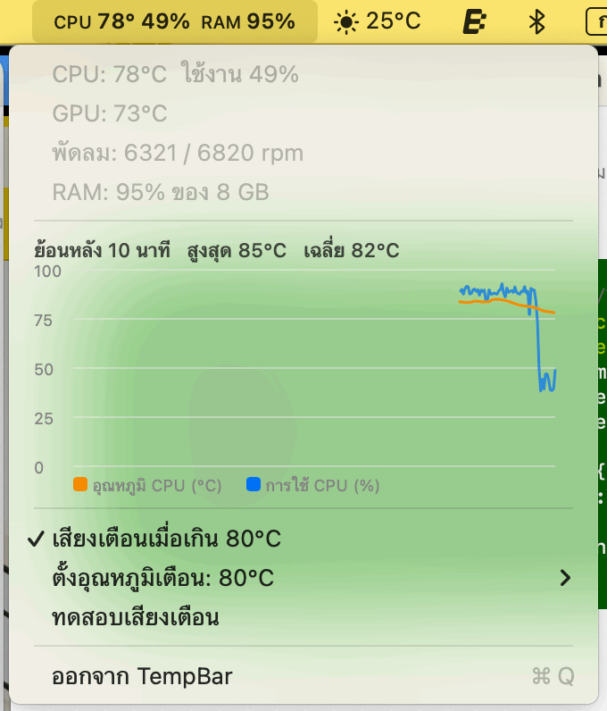

# TempBar 🌡

แอปเล็ก ๆ สำหรับ macOS ที่บอกอุณหภูมิเครื่องบน **แถบเมนูด้านบน** และบน **Touch Bar**

<p align="center"></p>

<p align="center"></p>

- อุณหภูมิ CPU / GPU และรอบพัดลม (อ่านตรงจาก SMC)
- การใช้งาน CPU และ RAM เป็น %
- กราฟย้อนหลัง 10 นาทีในเมนู
- เสียงเตือน **บี๊บ-บี๊บ** เมื่อเครื่องร้อนเกินค่าที่ตั้ง (เลือกได้ 65–95°C) เปิด/ปิดได้ทั้งจากเมนูและจาก Touch Bar
- บน Touch Bar สีจะเปลี่ยนตามความร้อน: เขียว < 60° · ส้ม < 80° · แดง ≥ 80° แตะแล้วจะเห็นรายละเอียด

## ติดตั้ง

เปิด Terminal แล้ววาง:

```sh
curl -fsSL https://raw.githubusercontent.com/Atomphat/tempbar/main/install.sh | zsh
```

แอปจะถูกติดตั้งไว้ที่ `~/Applications/TempBar.app` และเปิดเองทุกครั้งที่ login ไม่ต้องใช้รหัสผ่าน admin

> **Touch Bar:** ถ้าไม่เห็นไอคอน ให้ไปที่ System Settings → Keyboard → Touch Bar Settings แล้วตั้งให้แสดง **Control Strip**

### ถอนการติดตั้ง

```sh
curl -fsSL https://raw.githubusercontent.com/Atomphat/tempbar/main/install.sh | zsh -s -- --uninstall
```

## รองรับ

| เครื่อง | สถานะ |
|---|---|
| Intel Mac (มี/ไม่มี Touch Bar) | ✅ ทดสอบแล้วบน MacBook Pro 2018 |
| Apple Silicon (M1/M2…) | ⚠️ ใส่ sensor key ไว้แล้ว แต่ยังไม่ได้ทดสอบ ถ้าขึ้น `--` แจ้งใน Issues ได้ |

ต้องใช้ macOS 12 (Monterey) ขึ้นไป ส่วน Touch Bar ใช้ API ภายในของ Apple (แบบเดียวกับ MTMR / Pock) ถ้าอัปเดต macOS แล้วอาจใช้ไม่ได้

## Build เอง

ต้องมี Xcode Command Line Tools (`xcode-select --install`)

```sh
git clone https://github.com/Atomphat/tempbar.git && cd tempbar
./install.sh                 # build จาก source แล้วติดตั้ง
./build/TempBar.app/Contents/MacOS/TempBar --dump   # ดูค่า sensor ที่อ่านได้
```

ออก release ใหม่ (build แบบ universal แล้วอัปขึ้น GitHub Releases): `./make-release.sh 1.1.0`

อัดภาพ/GIF สำหรับ README: ดู `tools/demo.swift`
